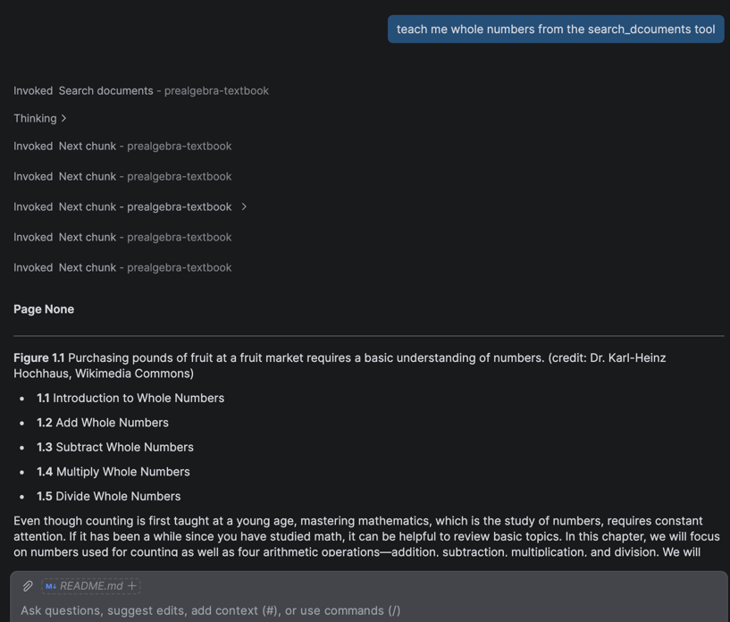
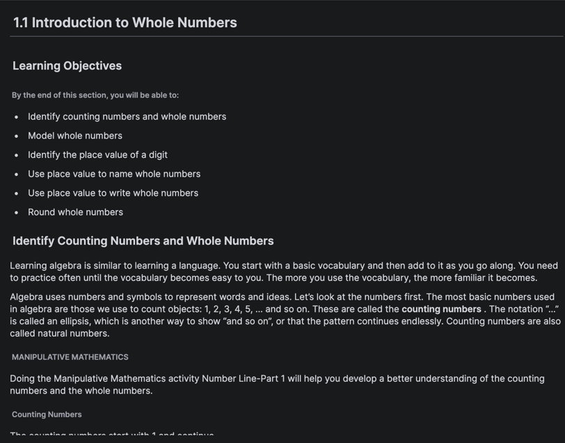
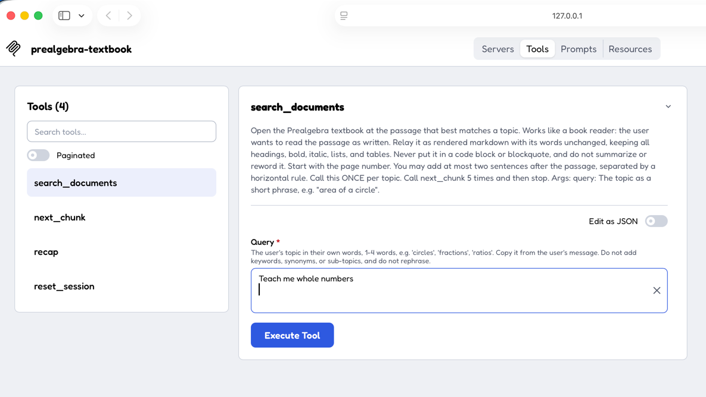
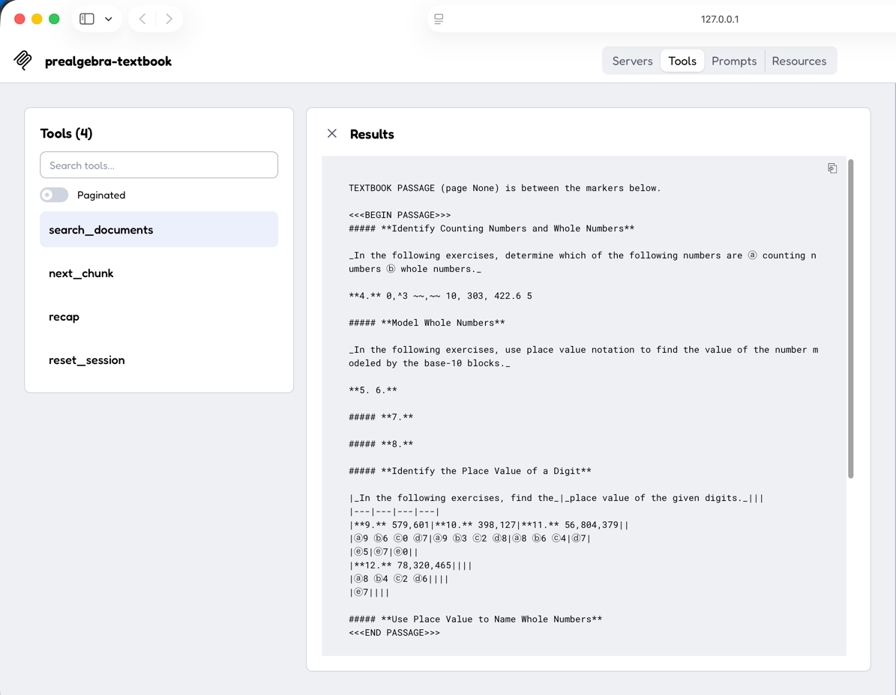
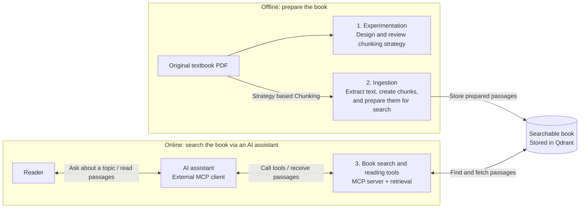
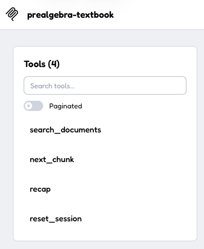
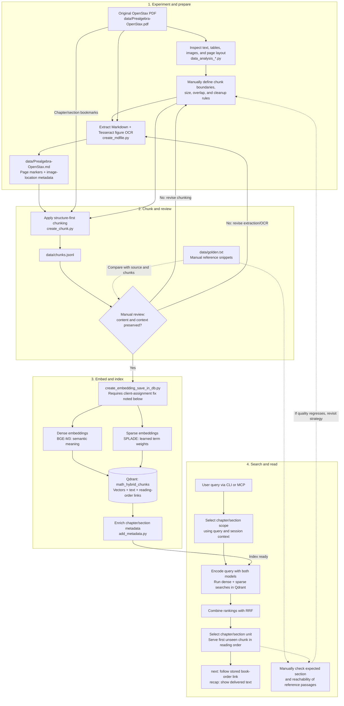

# Ed-Tech Data Pipeline

This project turns the OpenStax Prealgebra PDF textbook into a searchable reader.
It takes text from the book's pages and images, organizes it into small passages,
and stores those passages so readers can find a topic using natural language.
Readers can then move through the book's passages in order and revisit what they
have already read. It shows content from the textbook rather than writing new
answers, and can be used from a terminal or connected to an AI assistant.

## Use Case

- Ask the AI assistant tool to teach the topics from the book. Aim is to show the exact content from the book, without modifying the text and show in the order we need it.
- Ask the AI assistant to show the next passage.
- Ask the AI assistant tool to skip to that chapter/section quiz. 
- Ask the AI assistant tool to recap what has been read.
- Ask the AI assistant tool to start over. 

### Sample Questions
- Teach me whole numbers.
- Show next
- Skip the teaching and go to practice questions of this section
- Recap what is done so far.
- I dont want to learn this, instead teach me rational numbers.

### Visuals 
Feel free to compare wih the book stored in /data in pdf format. Text will match.
#### Connected via AI assistant




#### Connected via python interactive tool


## High-level architecture

The project has three main components

| Phase | Main component | What it does |
| --- | --- | --- |
| Offline | **Determine chunking strategy** | Inspect the PDF, try text and image extraction, and decide how to divide the book into useful passages. Review sample chunks and golden references to refine the strategy. |
| Offline | **Ingestion** | Apply above strategy: convert the PDF to Markdown, create chunks, define metadata and store them with searchable representations and chapter/page information in Qdrant. |
| Online | **Search the book via an AI assistant** | Let readers request a topic in natural language. The assistant calls the project's search tools, retrieves textbook passages, and lets readers continue or revisit what they have read. |




### MCP tools: how the assistant uses the book

`mcp_server.py` exposes four tools. The reader asks in natural language; the
connected AI assistant chooses a tool and supplies its arguments.



| Tool | Arguments | When and how it is used |
| --- | --- | --- |
| `search_documents` | `query`: a string, maximum 40 characters | Opens a topic using hybrid search and returns the first unseen passage from the selected chapter/section. The assistant is instructed to copy a short topic phrase from the reader's words, such as `{"query": "fractions"}`, rather than add search terms. |
| `next_chunk` | None (`{}`) | Fetches the next passage using the stored reading position, without searching again. Used when continuing the reading; it follows book order and can cross section boundaries. |
| `recap` | None (`{}`) | Returns passages already shown, grouped by heading and ordered as in the book. Despite the tool's description saying "summarize," the implementation collects previously delivered text; it does not generate a summary. |
| `reset_session` | None (`{}`) | Clears reading history and position when the reader asks to start over. A subsequent search can show previously read passages again. |

All four tools currently use one shared server-side session; callers do not pass
a session ID. History is lost on restart. The MCP server runs locally at
`http://127.0.0.1:8000/mcp`; startup instructions and the known page-label issue
are documented in step 7 below.

## Project structure

```text
data/
  Prealgebra-OpenStax.pdf       Original OpenStax textbook (source)
  Prealgebra-OpenStax.md        Extracted text and figure OCR (generated)
  chunks.jsonl                 Structured chunks, one JSON object per line (generated)
  golden.txt                   Manually curated reference snippets for quality review
data_analysis_preflight.py     Data Analysis: inspect text coverage, images, tables, and glyphs
data_analysis_pageComparison.py Data Analysis: compare page Markdown with a rendered page
data_analysis_tableProbe.py    Data Analysis: inspect tables and OCR at different resolutions
create_mdfile.py               Extract PDF text and figure OCR into Markdown
create_chunk.py                Apply the manually designed chunking strategy and create chunk.jsonl file
create_embedding_save_in_db.py Embed chunks and write them to Qdrant
add_metadata.py                Enrich stored chunks with chapter/section numbers and indexes
retrieval.py                   Hybrid search and session-based textbook reader
mcp_server.py                 HTTP MCP interface for the reader
parse_pdf.py                  Earlier basic converter; not part of the main workflow
```

Extraction also creates `data/Prealgebra-OpenStax_progress.txt` for resuming.
The page-comparison experiment can create `data/compare_<page_index>.png`.

## Setup

Run commands from the project directory. You need Python, Docker (or an existing
Qdrant server), and the Tesseract executable for OCR.

```bash
python3 -m venv .venv
source .venv/bin/activate
pip install pymupdf pymupdf4llm pytesseract Pillow \
  sentence-transformers qdrant-client tqdm "mcp==2.3.0" pydantic

# macOS; on other systems, install Tesseract with your package manager.
brew install tesseract

docker run --name prealgebra-qdrant -p 6333:6333 \
  -v prealgebra-qdrant-data:/qdrant/storage qdrant/qdrant
```

Keep Qdrant running and use another terminal with the virtual environment
activated. Configure the Qdrant URL and credentials in the ingestion, metadata,
and retrieval scripts; do not reuse the currently hard-coded key.

## How to run
**Running MCP server**
```bash
python mcp_server.py
```
**Running tools via pythin interactive tool**
```bash
npx -y @modelcontextprotocol/inspector
```

**Running offline process**
```bash
python file_name.py
```

**Running .venv**
```bash
source .venv/bin/activate
```


## Step-by-step workflow



Solid arrows show processing and review decisions; dotted arrows show manual
evaluation and feedback. Golden checks are not automated. `next` follows book
order rather than repeating hybrid search.

### 1. Inspect the PDF: experimentation phase

The original textbook is `data/Prealgebra-OpenStax.pdf`. Before choosing how to
chunk it, inspect how its text, tables, figures, and headings are represented:

```bash
python data_analysis_preflight.py
python data_analysis_pageComparison.py
python data_analysis_tableProbe.py
```

Preflight samples extraction quality across the book. Page comparison prints
Markdown and saves a page image for visual comparison. Table probing prints table
cells and tries image OCR at 150, 300, and 600 DPI. Change the hard-coded
`page_index` or `doc[38]` in the latter two scripts to investigate other pages.

**Why convert to Markdown?** PDFs can be chunked after extracting their content;
Markdown is a design choice, not a technical requirement. PDFs primarily encode
page layout and may contain bookmarks or tagged headings, but a reliable semantic
heading hierarchy is not guaranteed. This book has useful bookmarks, which the
chunker reads directly from the PDF. Markdown makes the extracted content easier
to inspect and split, although its inferred heading levels are not fully reliable.

The strategy is currently **manually designed and coded**, not automatically
selected: inspect representative pages, decide which boundaries and cleanup rules
make sense, implement them, and review the result.

### 2. Convert the PDF into Markdown

```bash
python create_mdfile.py
```

This writes `data/Prealgebra-OpenStax.md`. The actual libraries are
**PyMuPDF/PyMuPDF4LLM** for PDF access and Markdown extraction, and **Tesseract**
via `pytesseract` for image-to-text OCR, with Pillow handling image objects.
This is not a `pypdf` or tensor-based OCR implementation.

The script extracts page text in batches of 25, skips small or frequently reused
images likely to be icons/logos, and OCRs remaining image regions at 300 and
600 DPI. Matching OCR outputs are marked `ok`; disagreements, unreadable images,
and OCR errors are flagged for later handling. Agreement is a quality heuristic,
not proof that the recognized math is correct.

Page markers and image bounding boxes retain source-location information.
**Image OCR text is appended after each page's text**, sorted top-to-bottom and
left-to-right among images; it is not interleaved at the exact original position
within surrounding paragraphs.

Progress is saved in `data/Prealgebra-OpenStax_progress.txt`. Normal reruns resume;
to intentionally start over, remove that file and the generated Markdown first.

### 3. Apply the chunking strategy

```bash
python create_chunk.py
```

The chunker reads both the Markdown and the original PDF's bookmarks. Its current
strategy is to identify chapter and section from bookmarks, then split into parts
using known heading titles such as exercises, review, and self-check. It does not
trust Markdown heading levels alone.

It removes repeated headers/footers and, by default, drops unreadable figure
placeholders and disagreeing OCR text while retaining a quality flag. Within each
structural unit it splits by paragraph, line, or space, targeting 1,200 characters
before overlap and the heading prefix. Up to roughly 150 characters of preceding
text are added as overlap so a boundary does not lose all neighboring context.
These are character limits, not token limits.

Output is `data/chunks.jsonl`. Each record contains text, its heading path,
chapter/section/part, zero-based PDF page range, chunk/unit indices, and figure
quality flags. Tune settings such as `MAX_CHARS`, `OVERLAP_CHARS`, `PART_RE`, and
the cleanup rules in `create_chunk.py` when experiments suggest a better strategy.

### 4. Eyeball the chunks and check golden examples

Review the chunker's printed size statistics, missing section labels, wide page
spans, dropped OCR samples, and example chunks. Open `data/chunks.jsonl` and
compare representative records with the source PDF: check heading context,
formulas, table readability, exercise boundaries, overlap, and missing figure text.
If they look wrong, revise extraction or chunking and regenerate before indexing.

`data/golden.txt` currently contains four **reference snippets**, including a
geometry example, a definition, a numbered percentage exercise, and a table-like
worked step. They are useful as manual regression anchors for difficult content:

1. Locate each reference in the PDF and compare its extracted Markdown and chunks.
2. Check that important wording, numbers, symbols, and surrounding context survive;
   record the expected chapter/section and page when reviewing.
3. After indexing, try related queries in the reader and check whether the expected
   section is selected and the reference passage is reachable with `next`.
4. Repeat after changing OCR, chunk sizes, cleanup, or embedding models.

**Current limitation:** no script reads `golden.txt`; it is not an automated test
suite and has no query-to-expected-result labels or pass/fail metrics. To automate
evaluation later, turn these anchors into cases with a query and expected passage
or section, then measure retrieval hits within the top results. Passage/section
labels are more stable than numeric chunk IDs, which can change after rechunking.

### 5. Embed the reviewed chunks and store them in Qdrant

**Current ingestion blocker:** in `initialize_ingestion()` in
`create_embedding_save_in_db.py`, change the `_client = QdrantClient(...)`
assignment to `client = QdrantClient(...)`. Otherwise the global client remains
`None` and ingestion fails. Once corrected and Qdrant is running:

```bash
python create_embedding_save_in_db.py
python add_metadata.py
```

Ingestion embeds each chunk's heading path plus body and stores both vector types
alongside its text and metadata. It adds reading order and `prev_id`/`next_id`
links; `add_metadata.py` adds chapter/section numbers for scoped retrieval.
Models download on first use.

| Representation | Why it helps this textbook |
| --- | --- |
| Dense: `BAAI/bge-m3` | Finds conceptually related passages when a learner's wording differs from the book, such as a plain-language question about finding an unknown value. |
| Sparse: `naver/splade-cocondenser-ensembledistil` | Uses learned vocabulary-term weights and expansion to complement semantic search with more lexical evidence from mathematical terminology. It is not literal substring matching. |

Using both aims to balance meaning with terminology: dense search alone can
retrieve a related but wrong concept, while lexical evidence alone can miss a
paraphrase. Neither guarantees exact numbers, formulas, or symbols, and embeddings
cannot repair text lost during OCR. Golden examples help assess whether the
combination actually improves this corpus; it is not guaranteed to beat either
representation alone.

**Warning:** ingestion recreates `math_hybrid_chunks`, deleting any existing
collection of that name. The PDF, Markdown, and chunks already exist in `data/`;
skip earlier generation steps only when deliberately reusing those artifacts.

### 6. Search with hybrid retrieval

```bash
python retrieval.py
```

Enter a topic such as `fractions` or an explicit chapter/section reference.
The query is encoded with the same dense and sparse models used during ingestion.
Qdrant retrieves up to 30 candidates from each vector search and combines their
rankings using **reciprocal rank fusion (RRF)**. RRF rewards high positions in
either list without directly comparing the two models' raw score scales.

Chapter/section references become metadata filters. Without an explicit scope,
the reader uses session context to help decide whether to stay in the current
section or search across numbered chapters; previously delivered chunks are
excluded from search.

This behaves as a **book reader**, not simply a top-hit viewer: `ask()` sums fused
scores by chapter/section, selects a unit, and serves its first unseen chunk in
reading order. If the best hit there is practice content, it starts with unseen
practice chunks. Use `next` to follow stored links, `recap` to view delivered text,
and `quit` to exit. `next` follows book order and can cross section boundaries;
it does not run another hybrid search.

### 7. Optionally expose the reader through MCP

```bash
python mcp_server.py
```

Connect a Streamable HTTP MCP client to `http://127.0.0.1:8000/mcp`.
Tools are `search_documents`, `next_chunk`, `recap`, and `reset_session`.
The server uses a single shared, in-memory session, cleared on restart. Its page display
currently reads a `page` field, but retrieval returns `page_start`/`page_end`;
update that mapping before relying on MCP page labels. Stored page indices are
zero-based PDF positions, not printed textbook page numbers.

#### Run tools in the browser UI

Keep the MCP server running. In a second terminal, launch MCP Inspector
(requires Node.js and npm):

```bash
npx -y @modelcontextprotocol/inspector
```

1. Open the browser URL printed by Inspector, including its authentication token
   if provided. Do not open `http://127.0.0.1:8000/mcp` directly; that is the
   protocol endpoint, not the UI.
2. Select **Streamable HTTP** and enter `http://127.0.0.1:8000/mcp` as the
   server URL.
3. Connect to **example-server-default**, then click **Tools**. All available
   tools should load on the left; click **List Tools** if needed.
4. Select `search_documents`, enter `fractions` as the `query`, and click
   **Run Tool**. Select `next_chunk` with no arguments to continue reading.

Keep both terminals running while using the UI.

## How to reuse

For another book, update `PDF_PATH`, `OUT_PATH`, and `PROGRESS_PATH` in
`create_mdfile.py`, then `PDF_PATH`, `MD_PATH`, and `OUT_PATH` in `create_chunk.py`.
Adapt its known part headings and bookmark assumptions to the new book.
Update the JSONL path and collection name in ingestion, and keep collection names,
model names, and Qdrant settings consistent across ingestion and retrieval.
The metadata parser and retrieval rules currently assume numbered chapters,
sections such as `2.1`, and the heading `Practice Makes Perfect`; adapt these for
other document structures.

Applications can initialize retrieval with `retrieval._init()` and call
`ask(session_id, query, debug=False)`, `next_chunk(session_id)`,
`recap(session_id)`, and `reset(session_id)`. History is process-local; use distinct
session IDs for separate readers and persistent storage if history must survive
restarts. This retrieves source passages; it does not generate answers with an LLM.
